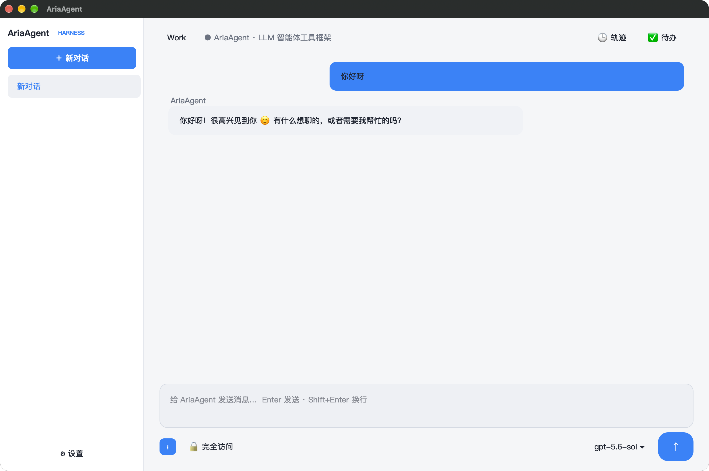
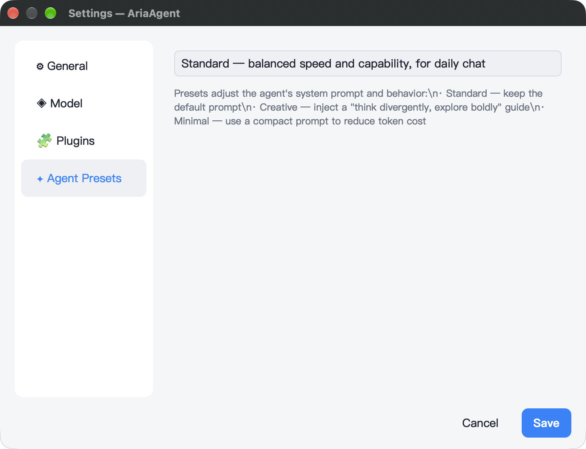

<div align="center">

# ✦ AriaAgent

[依赖更新完整指南](docs/dependencies.md) — 版本固定、选择性更新、离线、回退与提交步骤。

当前版本 **0.2.0** · Aria **3.1.1**

**工业级 C++23 Agent 工具框架 GUI** · 基于 [Aria](https://github.com/dqsjqian/Aria) (C++23 MVVM)

Provider 无关 · 真流式 SSE · 工具调用链可视化 · 权限审批 · MIT License

[](https://en.cppreference.com/w/cpp/23)
[](https://www.qt.io)
[](LICENSE)
[](https://github.com/dqsjqian/Aria)

[English](README.en.md) | [简体中文](README.md)

</div>

---

## 这是什么？

**AriaAgent** 是一个基于 Aria(C++23 MVVM 框架)构建的 **provider 无关 LLM Agent 工具框架 GUI**。
它不绑定任何一家模型厂商 —— DeepSeek / OpenAI / Kimi / Qwen / GLM 等所有 **OpenAI 兼容端点**开箱即用,换模型只需改一行配置,零代码改动、无需重新编译。

Agent 循环(思考 → 调工具 → 观察 → 再思考)用 C++23 协程实现,UI 层通过 Aria 的响应式引擎(Property / ObservableList)与引擎层彻底解耦。整体设计大量借鉴 DeepSeek 官方 harness 的架构精髓(事件日志 = 唯一事实源、工具 schema 驱动、权限默认拒绝)。

## ✨ 特性

### 🧠 Agent 核心
- **Provider 无关** —— 抽象 `LlmClient` 接口 + `OpenAiCompatClient` 实现,任何 OpenAI 兼容 API 无缝接入
- **真流式输出** —— token 级 SSE 流式渲染（Mira HTTP 客户端逐块读取响应体）,不是缓冲式假流式
- **Agent 循环** —— 协程式 思考/工具调用/观察 循环,多工具**有界并行**执行(exclusive 屏障 + 并行池,结果按模型顺序提交),硬性轮数上限防失控
- **工具注册表** —— 一次注册即插即用:`Tool{name, desc, schema, fn}`,无硬编码分支
- **参数校验** —— 轻量 JSON-Schema 校验器(类型/必填/枚举/范围),错误信息带 JSON 路径

### 🛠 内置工具(10+)
| 工具 | 说明 | 权限 |
|---|---|---|
| `calculator` | 四则/幂运算 | 无需审批 |
| `current_time` | 当前本地时间 | 无需审批 |
| `run_command` | 同步执行 Shell 命令(超时) | **需审批** |
| `run_in_background` / `read_output` / `kill_process` | 后台进程句柄 + 增量轮询 | **需审批** |
| `read_file` / `write_file` / `edit_file` | 文件读写改(防目录逃逸) | **写操作需审批** |
| `list_directory` | 目录列表 | 无需审批 |
| `todo_set` / `todo_add` / `todo_list` | Agent 可见待办(快照 last-wins) | 无需审批 |

### 🗂 会话与 UI
- **多会话管理** —— 侧边栏会话列表(新建/切换/右键删除),JSON 持久化到 `~/.ariaagent/sessions/`,重启自动恢复
- **多轮上下文** —— 引擎持有完整消息历史,Agent 有记忆
- **自动压缩** —— 超 32 条自动摘要压缩,不拆散 tool-call/result 配对
- **Markdown 渲染** —— 气泡内渲染 Markdown + 代码四色高亮
- **轨迹面板** —— 右侧工具调用时间线(成功/失败着色)
- **Todo 面板** —— Agent 的待办列表实时投影
- **消息反馈** —— 右键 👍/👎,持久化
- **权限审批** —— 危险工具执行前模态确认,默认拒绝(fail-closed)

### 🖼 截图预览

AriaAgent 基于 Aria C++23 MVVM + Qt6 适配器实现。下图来自 macOS 版本，对话与设置两个核心界面均使用 Aria 响应式引擎（`Property` / `ObservableList` / `Command`）驱动。

| 视图 | 截图 |
|---|---|
| 主界面（对话 + 工具调用链） |  |
| 设置（General / Model / Plugins / Agent Presets） |  |

> **关于 Windows / Linux 截图**：Mac 的壳基于 **Aria 框架 + Qt6 Adapter** 构建，在 Windows / Linux 上跑出来的程序与 Mac 视觉上完全一致（同一份 Qt 控件 + 同一份 C++ ViewModel），所以不必重复截图。Windows 下还另有 MSVC + Qt6 与 MSYS2 UCRT64 两条工具链可以独立验证。

## 🏗 架构分层（core 纯 C++ + 多平台壳）

```
AriaAgent/
├── core/                    # ★ 纯 C++,零 Qt 依赖(移动端直接复用)
│   ├── agent/               #   引擎层:agent 循环 / llm_client / 工具 /
│   │                        #   session_store / json_schema / subprocess
│   └── module_api/          #   BaseVm / IModule / ModuleRegistry / ServiceHub
├── modules/                 # ★ 业务模块(plugin pattern,每个模块自带 VM)
│   ├── chat/                #   聊天模块(引擎桥接 + ChatViewModel)
│   ├── sessions/            #   会话列表(侧边栏投影)
│   ├── settings/            #   设置 + Qt 设置对话框
│   ├── todo/  trajectory/   #   待办 / 工具调用轨迹
│   └── app/                 #   app 壳
│       ├── viewmodel/       #   AppText(UI 文案服务)
│       └── platforms/qt/    #   ★ 平台壳:main.cpp(QtDispatcher)/
│                            #     main_window / markdown_render
├── $FORGEDEPS_HOME/build/aria/<target>          # pinned Aria fetch (scripts/ci/fetch_aria.py)
├── core/CMakeLists.txt      # ariaagent_core
└── modules/app/platforms/qt/CMakeLists.txt  # aria_agent 可执行
```

> 注意:`platform/` 目录是早期残留的死代码,实际 Qt 壳在
> `modules/app/platforms/qt/`,构建以顶层 CMakeLists.txt 为准。
> iOS / Android 壳(未来)同样放 `modules/app/platforms/` 下,复用同一套 core。

**跨线程**:VM 通过 `aria::runtime::main_dispatcher()` 回到 UI 线程 —— Qt 壳在
`main.cpp` 里安装 `QtDispatcher`,iOS/Android 壳装各自的 dispatcher,VM 本身
完全不知道平台是谁。

**权限弹窗**:VM 只暴露 `approval_ui` 回调接口,由平台壳注入原生对话框
(QMessageBox / UIAlertController / Android Dialog),VM 永远不弹窗。

## 🚀 快速开始

### 前置
- **Windows UCRT64**：MSYS2 UCRT64（GCC 14+）、Qt6、CMake ≥ 3.21，以及 MSYS 的 `make`、`perl`（`pacman -S make perl`）；源码 OpenSSL 使用这两项工具。
- **Windows MSVC**：在 x64 Developer PowerShell 中运行 CMake，确保 `cl`、`nmake`、Perl 和 NASM 在 `PATH` 中；选择 Visual Studio 生成器不会自动为外部 OpenSSL 构建初始化开发环境。
- **macOS**:Xcode CommandLineTools、Qt6(brew install qt)、CMake ≥ 3.21
- **通用**:支持 C++23 的编译器、Git、Python 3.14+。
- 手动调用 CMake 前先解析并校验 Aria 依赖：

安装构建工具后，注册一个可供所有项目共享的工作区：

```bash
python -m pip install -r requirements-build.txt
python -m forgedeps init /path/to/ForgeDepsWorkspace
python scripts/build.py --test
```

默认从 `dependencies.json` 的已解析锁准备源码和 SDK；构建不自动选择新版本。`FORGEDEPS_HOME` 可覆盖已注册工作区。源码位于工作区 `sources/`，Aria 和第三方产物位于 `build/<name>/<target>/`；应用直接链接此处，每个目标只保留当前产物。版本、编译器、ABI、源码或配方变化会触发显式构建替换，失败保留旧产物。

`--aria-root /path/to/Aria`（CMake 的 `ARIA_DIR`，Tutorial 为 `ARIA_ROOT`）提供可编辑源码；其内容仍被哈希并编译进共享 SDK，不再嵌入应用子目录。Qt、NDK 和 Apple SDK 由用户安装，实际工具链与 Qt 内容进入产物身份。更新版本使用 `scripts/ci/update_dependencies.py`，审查并提交锁文件。

Python 入口持有配置、编译、测试和部署所需的消费锁。手工命令使用 `python -m forgedeps.build_kit.session --configure -- cmake -S ... -B ...`，后续构建/测试使用 `python -m forgedeps.build_kit.session --build-dir <build> -- <command>`。离线构建要求已准备对应源码、归档和工具链；不兼容或被改动的产物会失败。

`fetch_aria.py` 只用于单独准备共享源码；本地镜像开发 checkout 使用 `--source <repo> --destination <path>`。默认应用构建不需要先运行此命令。


### 统一 Python 入口

`python scripts/build.py --test` 准备共享 Qt/HTTP/TLS SDK，再在消费锁内配置、编译、运行测试与部署。支持 `--qt-dir`、`--aria-root`、`--build-dir`、`--jobs`、`--generator` 和 `--generator-platform`；Debug 使用 `debug` 子命令，`--offline` 要求已有依赖缓存。Windows 的外部 OpenSSL 构建需要 Developer PowerShell 与 Perl/NASM，当前仅支持 Qt 桌面壳。

### 一键构建(macOS / Linux)

```bash
python scripts/build.py             # Release
python scripts/build.py debug       # Debug
python scripts/build.py run         # Debug 构建并运行
python scripts/build.py clean       # 清理全部构建产物
```

脚本每次构建都会校验 Aria 锁定提交、探测 Qt6/Ninja，并使用 `build/flavors/<配置>/` 隔离构建目录。非 Homebrew Qt 可通过 `QT_DIR=/path/to/qt python scripts/build.py` 指定。

### 一键构建(Windows)

```powershell
python scripts/build.py             # Release + 部署运行时 DLL
python scripts/build.py debug       # Debug + 部署运行时 DLL
python scripts/build.py run         # Debug 构建、部署并运行
python scripts/build.py clean       # 清理全部构建产物
```

脚本会自动探测 MSYS2 UCRT64、Qt6 和 Ninja；非标准安装位置可通过 `$env:MSYS2_ROOT`、`$env:QT_DIR` 指定。

### 验证

```bash
python scripts/build.py --test
```

测试包括依赖拉取安全回归，以及使用本地 HTTP 服务验证普通响应和 SSE 流式响应的 `llm_client_smoke`；无需配置 LLM API 密钥。

### 配置 & 运行

应用内置设置对话框(左下角 ⚙),或直接使用环境变量:

| 变量 | 说明 | 默认值 |
|---|---|---|
| `ARIA_LLM_API_KEY` | API 密钥 | — |
| `ARIA_LLM_BASE_URL` | OpenAI 兼容端点 | `https://api.deepseek.com` |
| `ARIA_LLM_MODEL` | 模型名 | `deepseek-chat` |
| `ARIA_LLM_SYSTEM_PROMPT` | 系统提示词 | 默认助手提示 |

```powershell
$env:ARIA_LLM_API_KEY  = "sk-..."
$env:ARIA_LLM_BASE_URL = "https://api.deepseek.com"
$env:ARIA_LLM_MODEL    = "deepseek-chat"
./build/flavors/debug/bin/aria_agent.exe
```

> 换厂商:把 `BASE_URL` 改成 `https://api.openai.com` + `gpt-4o-mini`,或 `https://api.moonshot.cn` + `kimi-k2-0711-preview`,无需重新编译。

### 发布构建

```powershell
python scripts/build.py release
```

## 🧩 扩展

### 添加一个新工具(注册一行)

```cpp
reg.register_tool({
    "web_search",                            // 工具名
    "Search the web for a query.",           // 描述
    {                                        // JSON Schema 参数
        {"type", "object"},
        {"properties", {{"query", {{"type", "string"}}}}},
        {"required", json::array({"query"})}
    },
    /*concurrency_safe=*/true,               // 可并行
    /*requires_approval=*/true,              // 需审批
    web_search_impl                          // 实现函数
});
```

### 切换模型厂商
见上方环境变量表。`ARIA_LLM_BASE_URL` + `ARIA_LLM_MODEL` 即可,`LlmClient` 抽象层保证零代码改动。

## 📚 设计来源

架构设计大量参考 DeepSeek 官方开源 harness([deepseek-ai/deepseek-harness](https://github.com/deepseek-ai/deepseek-harness))的核心思想:

1. **事件日志 = 唯一事实源** —— 会话可回放、可压缩、可多视图同步
2. **工具 = schema + fn** —— 注册即插即用
3. **UI 永不直接碰引擎** —— 中间只有响应式状态
4. **权限默认拒绝** —— 危险操作必须显式审批
5. **可回放** —— 任何状态都能从日志重建

## 📄 License

[MIT](LICENSE) © 2026 dqsjqian

自有代码采用 MIT；第三方组件保留各自协议。分发说明见 [第三方许可声明](THIRD_PARTY_NOTICES.md)。
